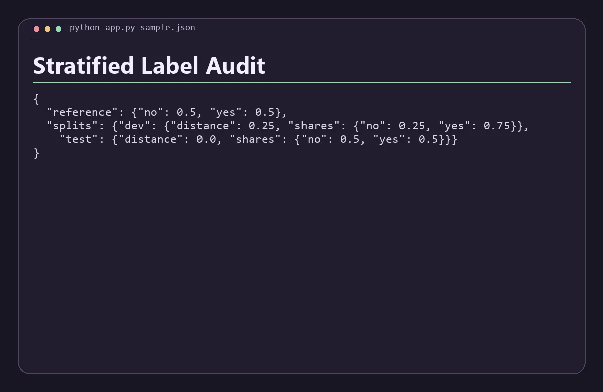

# Stratified Label Audit

Compare label distribution between reference data and evaluation splits using total variation distance.



## Run

Install Python 3.11 or newer. Run these commands from the repository root.

```sh
python app.py sample.json
```

Replace `sample.json` with a JSON file following the same structure. The app prints a JSON report to standard output.

Provide nonempty lists of string labels. The audit includes labels across all sets. Total variation is half the sum of absolute differences in label proportions.

## Verify

Run `python check.py` with Python 3.11 or newer after the build step when applicable. The check verifies the bundled scenario and confirms that an invalid input returns an error.
